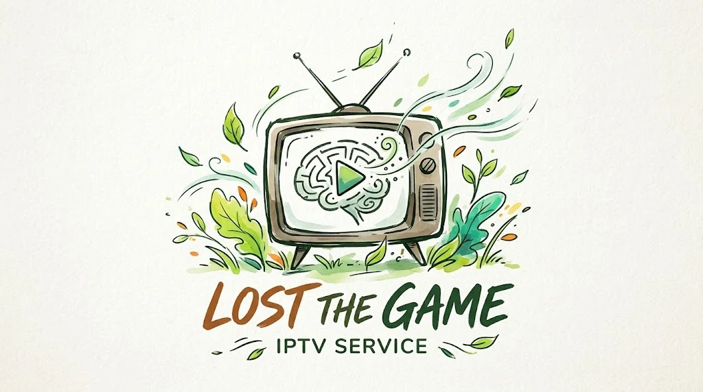

<p align="center">
  
</p>

<p align="center">
  <a href="https://github.com/rikmartins/IPTVLostTheGame/releases/latest"></a>
</p>

## Download

Os links descarregam sempre a versão mais recente.

| Dispositivo | Download direto |
|---|---|
| Android (telemóvel e tablet) | [LostTheGame-Android.apk](https://github.com/rikmartins/IPTVLostTheGame/releases/latest/download/LostTheGame-Android.apk) |
| Android TV | [LostTheGame-AndroidTV.apk](https://github.com/rikmartins/IPTVLostTheGame/releases/latest/download/LostTheGame-AndroidTV.apk) |
| Windows (instalador) | [LostTheGame-Setup.exe](https://github.com/rikmartins/IPTVLostTheGame/releases/latest/download/LostTheGame-Setup.exe) |
| Windows (MSI) | [LostTheGame-Windows.msi](https://github.com/rikmartins/IPTVLostTheGame/releases/latest/download/LostTheGame-Windows.msi) |

**Android / Android TV:** ao abrir o APK, o Android pede para autorizar a
instalação de apps desconhecidas para o browser (ou para a app que usaste
para descarregar, como a *Downloader* na TV).

**Windows:** o `.exe` instala só para o teu utilizador e as atualizações não
pedem administrador; o `.msi` instala para todos os utilizadores do PC. Como
o instalador ainda não tem assinatura digital, o SmartScreen pode avisar:
*Mais informações → Executar mesmo assim*.

Depois de instalada, a app procura novas versões em
**Definições → Aplicação**.

---

Cliente IPTV (Xtream Codes) em Flutter para Android, Android TV e Windows.

- Catálogo (canais, filmes, séries e guia TV) sincronizado para uma base de
  dados local (Isar) num isolate próprio; a interface lê só daí.
- Vários perfis (por exemplo *IPTV X* e *IPTV Y*), cada um com a sua lista
  guardada no dispositivo: mudar de perfil é imediato. Em
  **Definições → Perfis**, ou no nome do perfil no topo de cada secção.
- Reprodução com media_kit (libmpv) e perfis de pré-buffer
  (Rápido / Normal / Estável).
- VPN pessoal em **Definições → VPN**, de duas formas:
  - **WireGuard**, com um ficheiro `.conf` (Android e Windows). No Android
    pode passar só o tráfego da app; no Windows pede administrador só na
    primeira ligação.
  - **IKEv2**, com as credenciais VPN da subscrição (na PureVPN, em
    *Subscriptions*; não são o email e a palavra-passe da conta), que não
    expiram como um `.conf`. Usa o IKEv2 do próprio sistema: Windows, e
    Android 11 ou mais recente.

  Se o servidor não responder, a app desliga a VPN sozinha para não ficares
  sem internet.
- Na TV, o login e o `.conf` da VPN podem ser preenchidos no telemóvel:
  lê o código QR no ecrã e preenche a página que abre (mesma rede Wi-Fi;
  os dados não passam pela internet).
- Opção **Memorizar dados** no login.
- Tema claro ou escuro, e atualizações a partir das releases deste
  repositório.

## Desenvolvimento

```bash
flutter pub get
dart run build_runner build   # depois de mudar modelos em lib/data/local/models
flutter analyze
flutter test
flutter run -d windows
flutter run --flavor mobile   # Android (telemóvel/tablet)
flutter run --flavor tv       # Android TV
```

No Android há duas variantes (flavors) com o mesmo identificador
(`com.iptvapp.lostthegame`): `mobile` e `tv`. Só o manifest muda
(`android/app/src/tv`: launcher e banner da TV).

## Publicar uma versão

1. **Uma única vez:** criar a chave de assinatura Android e os secrets do
   GitHub:

   ```powershell
   powershell -ExecutionPolicy Bypass -File tool\setup_android_signing.ps1
   ```

   Guarda `android/upload-keystore.p12` e a palavra-passe num gestor de
   palavras-passe: sem eles não há mais atualizações para quem já instalou.

2. Criar e enviar a tag:

   ```bash
   git tag v0.2.0
   git push origin v0.2.0
   ```

   O workflow `Release` publica sempre os quatro ficheiros da tabela de
   download (ou nenhum). Os nomes não levam a versão, para os links acima
   apontarem sempre para a mais recente; a versão da app vem da tag. O
   atualizador da app descarrega sempre a mesma variante que está instalada.

   Tags com hífen (`v0.2.0-beta.1`) saem como pré-release e a app não as
   oferece como atualização.
